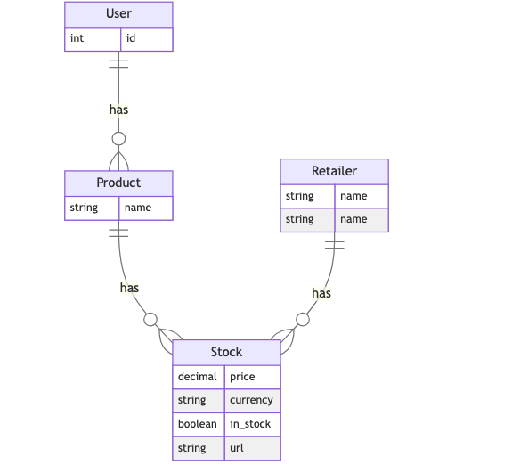
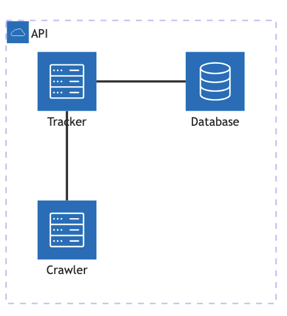

## Getting Started

```bash
php artisan queue:work
```

```bash
php artisan track
```

## Diagrams

### ERD
  
Stocks belong to many products, which means it can be shared between multiple users, hence we don't have to track redundant stock, while keeping our database size small.

### Architecture


### Queue

All the tracking jobs are queued and processed by the queue worker with a delay of 4 mins.


## Technologies stack
### Email Services 
- For the email service we use aws ses 

### Frontend 
- We use Vue.js and Tailwind CSS 


### UML Diagram

### Design

- TrackProduct Job is scheduled will check if the product is in stock or not, and update the stock status in the database. And dispatch an event if the stock status changes.
- Regex is used to validate the product url 

- If the product never tracked before, the value of the product will be set to false / 0 in the database

- Product model has a method called `track` which will be called the track method on each stock of the product.

### Events

We have 2 events to track the availability of the product and price change of the product.

- NowInStock
- PriceDropped

## Testing 

We have 3 level of testing
- Unit Testing
- Feature Testing
- Integration Testing

```bash
php artisan test
```


